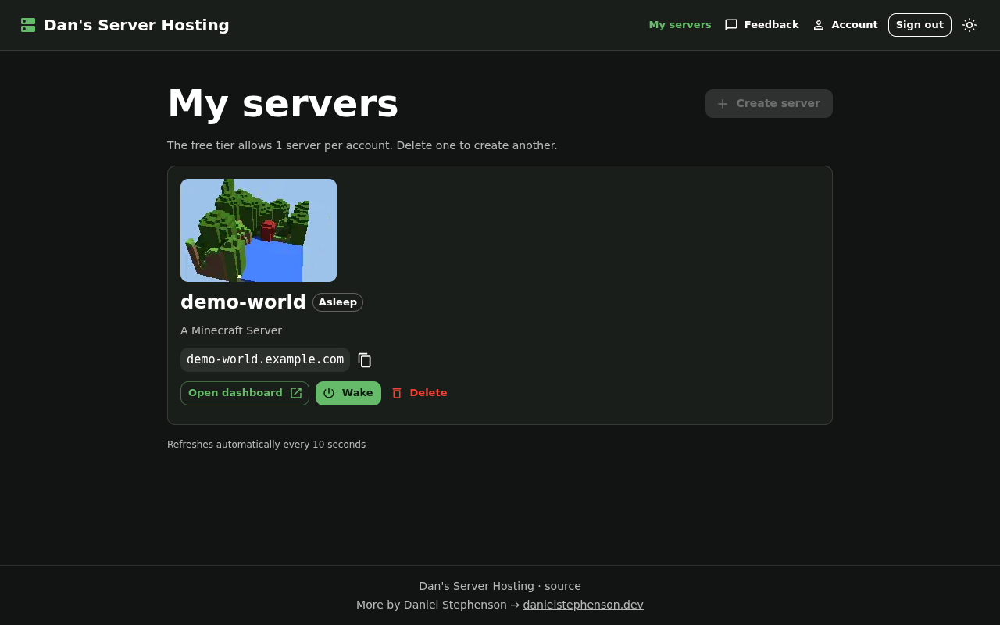
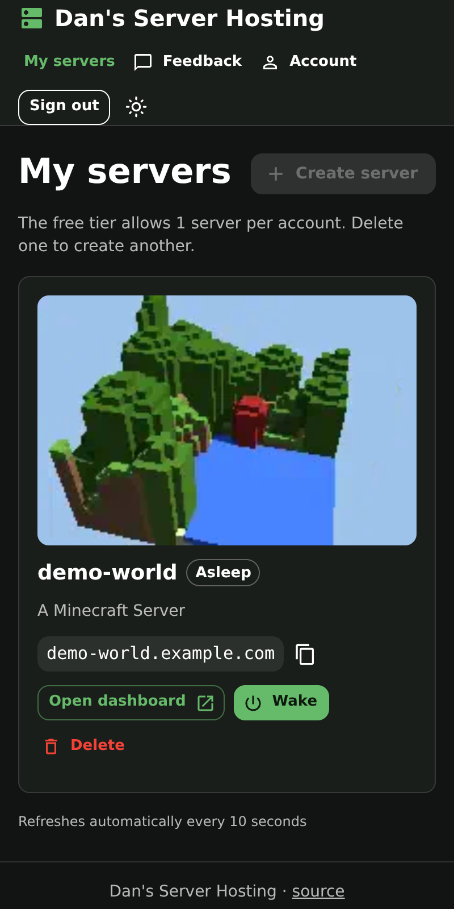

# dsh-portal

Web portal for **Dan's Server Hosting**: sign in, create a server, see whether
it is awake, and tell the team what is wrong. See [MVP.md](MVP.md) for the
scope.

Status: **MVP implemented, deploy manifests written, not yet deployed** —
every page, sign-in and registration against UserAuth's REST API, and the
delete/wake actions are built and smoke-tested against an in-memory mock of
`dsh-api` and UserAuth. The last step of the MVP (a stranger going from `/`
to a joinable address) can be measured once `dsh-api` and UserAuth are
running in the cluster.

## What it is

- Next.js (App Router) + MUI, TypeScript. Same stack as preponderous.org.
- Dark by default, with a sun/moon toggle at the right of the header. The
  choice is kept in the browser (`localStorage`, key `mui-mode`) and applied
  by an inline script before the first paint, so there is no flash of the
  other mode on the next visit. Both palettes live in `src/theme.ts`; the
  default mode is one constant in `src/lib/color-mode.ts`.
- Talks only to `dsh-api`. Holds no cluster credentials and no database.
- UserAuth is a plain REST API with no hosted pages, so the portal has its
  own sign-in and registration forms. Their server actions call UserAuth's
  `POST /login` and `POST /register`; the returned JWT is kept in an
  `httpOnly`, `Secure`, `SameSite=Lax` cookie (lifetime from `expiresAt`) and
  is only ever read by server-side code, which forwards it to `dsh-api` as a
  Bearer token. The browser never sees the token; it talks to the portal's
  own `/api/*` route handlers (`/api/servers*`, `/api/catalog`,
  `/api/feedback*`, `/api/account/password`). Sign-out revokes the token with
  `POST /logout` before clearing the cookie. A token that has died while its
  cookie lived on (a password change elsewhere signs other sessions out) loses
  the cookie on the first 401 from `withSession` or the password handler, and
  the browser goes to sign-in. A server-rendered page that gets that 401 (the
  server list, a server's page, the admin feedback page) cannot clear a cookie
  itself, so it renders `SessionExpired`, which calls `GET /api/servers` once
  to the same end. The export preview's file handler answers that 401 without
  clearing it; the page's next poll does.
- Creating a server is asynchronous: `POST /api/v1/servers` answers **202**
  with the server in state `provisioning` (and the one-time dashboard
  password), and the created view shows the address straight away with a
  live status line that asks for the server every 5 seconds ("Setting up…
  usually about a minute" → "Starting…" → "Online — ready to join"). While
  the request itself is in flight the button is disabled and a progress bar
  says so. A second create during that window is answered by the API with a
  409 naming the pending server; the portal says "A server is already being
  created for your account" and links to it, instead of the cap message.
- State pills (`provisioning`, `asleep`, `waking`, `awake`, `stopped`,
  `failed`) refresh every 10 seconds (while the tab is visible) without a
  page reload. `stopped` is a game that exited while its pod stayed up (Stop
  in the dashboard, or a crash); Wake is enabled for it, as for `asleep` and
  `failed`.
- Deleting a server requires typing its name back and says up front that a
  backup is taken first.
- Every signed-in page has a **Feedback** link in the header. It opens a
  textarea (4000 characters) and sends the message, plus the path the user
  came from, to `POST /api/v1/feedback` through the portal's own route
  handler. The API's 422 and 429 (ten a user an hour) are shown plainly.
- **Account** (`/account`, linked from the header) changes the password:
  current, new and confirm, with the same live rule checklist as
  registration plus "different from your current password". The portal's
  own `POST /api/account/password` route handler forwards
  `{ currentPassword, newPassword }` to UserAuth's change-password endpoint
  with the session's Bearer token. UserAuth's 204 is shown as success with a
  note that every other session was signed out (this one stays); its 401
  (wrong current password) and 400 (policy, or the same password again) are
  shown plainly, as is any other refusal in its own words. The endpoint's
  path defaults to `POST /password` and is
  read from `USERAUTH_CHANGE_PASSWORD_PATH`, so `/password/change` (or
  wherever it settles) is a config change, not a rebuild.
- `GET /api/v1/me` is fetched server-side, once per request, whenever there
  is a session. When it says `is_admin`, the header gains **Admin · Feedback**
  and `/admin/feedback` lists what users sent (username, relative time, page,
  message) with a New / Read / All filter and a Mark read / Mark new toggle
  per item (`PATCH /api/v1/feedback/{id}` through the proxy). Anyone else
  gets the ordinary "not found" page there; the API enforces the same rule
  with a 403, which the proxy passes through.
- **Plugins** on the server page (RFC 0020, dsh-api `/api/v1/servers/{name}/plugins`):
  the installed plugins with a Remove button each (disabled, with "Needed by
  Fiefs", while another plugin requires it), and **Add plugins**, which opens
  the Dan's Plugins catalog (`GET /api/v1/catalog`, through the portal's own
  `/api/catalog`) as a bottom sheet on phones and a dialog on wider screens:
  icon, title, version, description, tags, "Also installs Medieval Factions"
  and an Install button, with a search box. Removing says the plugin's data
  is kept, and when a removal leaves an automatically added dependency
  unused the portal offers to remove it too (never unasked). While a change
  waits for the next start a banner says so: an asleep server applies it at
  its next wake; an awake one has **Restart to apply**, which asks "N players
  are online. Restart now?" first when anyone is on. While dsh-api has
  `DSH_PLUGIN_SELECTION` off (the plugin endpoints answer 503) the page shows
  the default plugins as before.
- **3D export** on the server page (RFC 0021, dsh-api
  `/api/v1/servers/{name}/exports`): **Export world as 3D** turns a box of the
  world (256 × 256 blocks around spawn by default, or two corners typed under
  **Choose area**, up to the API's `export_max_size`) into an OpenUSD zip. The
  export's progress (Queued → Copying world → Building 3D → Ready, or Failed
  with the reason) refreshes every 5 seconds while it runs. A ready export
  shows its box, block count, zip size, how long it is kept, and whether the
  copy was exact (taken while asleep) or taken while the server ran — with a
  warning when the server kept saving during the copy. **Preview** opens the
  [usd-web](https://github.com/Preponderous-Software/usd-web) three.js viewer
  over the export's preview tiles (full screen on phones; drag to turn, pinch
  to zoom, two fingers to move). The viewer is vendored unmodified in
  `src/vendor/usd-web/` at v0.1.0 with its MIT licence, with `three` pinned to
  the version it pins (0.160.0); both load only when Preview is pressed.
  **Download (.zip)** asks for a short-lived signed link and follows it, so the
  file comes straight from the API. The daily limit (429) is shown with the
  time to wait. While dsh-api has `DSH_WORLD_EXPORT` off (503) the section is
  not shown at all.
- **World thumbnail** (RFC 0034, dsh-api `/api/v1/servers/{name}/thumbnail`):
  a small looping 3D picture of the world around spawn, shown only to the
  server's owner. On the server page, **Draw a picture** (then **Refresh
  picture**) asks dsh-api to draw it, with progress, the reason when a run
  fails (the previous picture is kept) and the daily limit. The card on
  `/servers` then shows the picture and leads to the server page. A
  `<picture>` serves the still poster to browsers that ask for reduced motion.
  Both files come through same-origin proxies with the session's token. While
  dsh-api has thumbnails off (503) nothing is shown.

  

  

  *The mock's made-up `demo-world` with the mock's fixture picture (the
  committed 26.3 fixture world of Minecraft-USD-Exporter, drawn by
  `mc-usd-thumbnail`), at the Playwright desktop (1280 × 800) and phone
  (400 × 800) viewports. The picture turns on the live page; a screenshot
  holds one frame. Regenerate with `npm run build && README_SCREENSHOTS=1 npx
  playwright test e2e/readme-screenshots.spec.ts` (the test is skipped
  otherwise).*

| Route | Shows |
|---|---|
| `/` | the free tier (limits fetched live from `GET /api/v1/limits`), what comes installed (`GET /api/v1/default-plugins`: name, version, description, link to the project) and where more plugins come from (the catalog on the server page while `GET /api/v1/catalog` answers, else the dashboard), how sleeping works, Sign in |
| `/servers` | the signed-in user's servers: name, address to copy, state pill, Open dashboard, Wake, Delete, and the world thumbnail when there is one |
| `/servers/new` | name, MOTD, Minecraft username (becomes operator); a line naming the plugins it comes with → create (202); address + one-time password with a live status until online; 403/409/422 shown in plain language, "already being created" links to the pending server |
| `/account` | who is signed in, and a change-password form (current, new, confirm, live rules) → UserAuth via `POST /api/account/password` |
| `/servers/[name]` | one server: address, state, last woken, dashboard link, its plugins (install from the catalog, remove, restart to apply; the default plugins while selection is off), 3D export (while dsh-api has it on), the world thumbnail with Draw/Refresh (while dsh-api has it on), delete with typed confirmation |
| `/feedback` | a textarea with a counter → `POST /api/v1/feedback` with `page` = where the user came from; thanks on success |
| `/admin/feedback` | admins only: feedback newest first, New / Read / All filter, Mark read / Mark new; "not found" for everyone else |
| `/auth/login` | username + password → UserAuth `POST /login`; a 401 is shown plainly |
| `/auth/register` | username, password (rules hinted as you type), optional email → `POST /register`, then signed in |
| `/auth/signout` (POST) | revokes the token at UserAuth and clears the cookie |
| `/api/servers`, `/api/servers/[name]`, `/api/servers/[name]/wake` | the server proxies: list and create (202), one server and delete it (`?force=true` passed on), and wake (202); a create whose body is not a JSON object is the portal's own 400, a name that is not a string counts as empty (the API's 422), and a MOTD or operator that is not a string is left out |
| `/api/feedback`, `/api/feedback/[id]`, `/api/account/password` | the feedback proxies (send, the admin list with `?status=new\|read\|all`, `PATCH` an item to `read` or `new`; a bad filter, id or status, or a body that is not a JSON object, is the portal's own 400, and a message that is not a string counts as empty) and the change-password handler, which answers such a body with a 400 too and UserAuth's 401 for a wrong current password as a 403 so the browser does not take it for an expired session |
| `/api/servers/[name]/plugins…`, `/api/catalog` | the plugin proxies: the server's plugins, install and remove one (`PUT` / `DELETE` `plugins/[slug]`), and `apply`, which sends `confirm_players: false` unless the browser sent exactly `true`; `/api/catalog` needs no session, as the catalog is public at `dsh-api` |
| `/api/servers/[name]/exports…` | the world-export proxies: list/start, one/delete, `link`, and `preview/[file]`, which passes usd-web's `index.json` and `*.uwt` tiles through as bytes (any other file name is a 404) |
| `/api/servers/[name]/thumbnail…` | the world-thumbnail proxies: the status and Draw/Refresh, and `[file]`, which passes only `thumb.webp` and `poster.png` through (any other file name is a 404) |
| `/api/health` | what the Kubernetes probes ask: 200 with no session and no call to `dsh-api`, so a slow API does not restart the portal |
| `/robots.txt`, `/sitemap.xml` | generated from `src/app/robots.ts` and `src/app/sitemap.ts`: the signed-in pages and `/api/` are disallowed, and the sitemap lists the public pages (`/`, `/auth/login`, `/auth/register`) |

The public pages carry a canonical link, a description, and Open Graph /
Twitter (`summary_large_image`) tags, all built in `src/lib/site.ts`. Their
absolute URLs come from the constant `SITE_URL` (`https://dansserverhosting.com`),
never from `PORTAL_URL` or the request, so a local or test build cannot emit
localhost links. The preview image is `public/og.png` (served at `/og.png`): a
1200×630 PNG of the favicon, the site name, `SITE_DESCRIPTION` and the domain,
in the dark theme's colours. Its size and alt text are in `OG_IMAGE`; if the
image is redrawn, keep them in step (`e2e/seo.spec.ts` checks the served size).

## Configuration

All variables are read on the server only; nothing is exposed as
`NEXT_PUBLIC_`. See [.env.example](.env.example).

| Variable | Meaning |
|---|---|
| `DSH_API_URL` | Base URL of `dsh-api`, e.g. `https://api.example.com` |
| `USERAUTH_URL` | Base URL of UserAuth's REST API (`POST /login`, `/register`, `/logout`, the change-password endpoint) |
| `USERAUTH_CHANGE_PASSWORD_PATH` | Path of UserAuth's change-password endpoint under `USERAUTH_URL`; defaults to `/password`, and a value without its leading `/` gets one |
| `PORTAL_URL` | The portal's own public origin, used for redirects after sign-out (defaults to the request origin) |
| `DSH_SECURE_COOKIE` | `0` allows the session cookie over plain http for local development; defaults to on in production |

## Running locally

```sh
npm ci
cp .env.example .env.local     # points at the mock below
npm run mock                   # terminal 1: mock dsh-api + UserAuth on :4000
npm run dev                    # terminal 2: portal on :3000
```

The mock (`mock/server.mjs`, zero dependencies, in-memory) implements the
`dsh-api` contract the portal codes against (`/api/v1/limits`,
`/api/v1/default-plugins`, servers, `/api/v1/me`, the feedback endpoints
with their 403 / 422 / 429 behaviours, and plugin selection: `/api/v1/catalog`
and the per-server plugin endpoints, with a small catalog in which Fiefs and
Currencies require Medieval Factions and ViaBackwards requires ViaVersion, so
a new server's ViaVersion, one of its default plugins, cannot be removed
("Needed by ViaBackwards") while ViaBackwards is installed; `POST /mock/plugins` with
`{ "enabled": false }` switches selection off, as `DSH_PLUGIN_SELECTION` does) plus UserAuth's
`/register`, `/login`, `/session/validate`, `/logout` and the change-password
endpoint (at `USERAUTH_CHANGE_PASSWORD_PATH`, default `/password`) with the
same status codes and password rules, under `/userauth`. A create answers 202
in state `provisioning` and moves to `waking` and then `awake` by itself over
`MOCK_PROVISION_MS` (default 6 s); a second create in that window is the 409.
Wake moves an asleep, stopped or failed server to `waking` and then `awake`
after `MOCK_WAKE_MS` (default 3 s). The mock listens on `127.0.0.1` at
`MOCK_PORT` (default 4000); if it is moved, change `DSH_API_URL` and
`USERAUTH_URL` in `.env.local` to match. Plugin selection is on unless the
mock is started with `MOCK_PLUGIN_SELECTION=false`, in which case the plugin
endpoints answer 503 and the server page shows the default plugins;
`POST /mock/plugins` switches it while running, and `POST /mock/reset` puts it
back to what `MOCK_PLUGIN_SELECTION` says. World export is **off** unless the
mock is started with `MOCK_WORLD_EXPORT=1` (its endpoints answer 503 and the
server page has no 3D export section); `POST /mock/world-export` with
`{ "enabled": true }` switches it while running, and an optional
`"outcome": { "snapshot": "live_changing" }` or `{ "error": "..." }` sets how
the next exports finish (`POST /mock/reset` puts both back: on or off
as `MOCK_WORLD_EXPORT` says, and exports that finish with an exact copy).
An export moves from `queued` through the copying, exporting and packaging
phases to `ready` over `MOCK_EXPORT_MS` (default 3 s); its preview serves a real usd-web tile set committed in
`mock/fixtures/world-export/preview/` (exported from Minecraft-USD-Exporter's
26.3 fixture world), the link endpoint returns a `/mock/download/{token}` URL
that serves a small zip without a session, and the sixth export in a day is
the 429. World thumbnails are **off** unless the mock is started with
`MOCK_THUMBNAILS=manual` (`thumbnail_mode` in `GET /api/v1/limits` says
`off`, the thumbnail endpoints answer 503 and nothing is shown);
`POST /mock/thumbnails` with `{ "mode": "manual" }` switches them on while
running, and an optional `"outcome": { "error": "..." }` makes the next runs
fail (`{}` lets them succeed again); `POST /mock/reset` puts the mode back
to what `MOCK_THUMBNAILS` says and lets runs succeed. A run moves from
`queued` through `running` to `ready` over `MOCK_THUMBNAIL_MS` (default
2 s), the picture is the committed fixture in `mock/fixtures/world-thumbnail/` (`thumb.webp` and
`poster.png`), and the fourth run on a server in a day is the 429. The mock
also has test-only controls: `POST /mock/reset`,
`POST /mock/feedback/reset`, `POST /mock/servers/{name}/state` with
`{ "state": "awake", "players_online": 1 }` to simulate a player joining (or
`"stopped"`, or anything else; it also stops the automatic progression for
that server), `POST /mock/servers/{name}/advance` to move a server one
step along provisioning → waking → awake right away, and
`POST /mock/servers/{name}/cluster-error` with `{ "detail": "..." }` to make
wake and delete on that server answer `502 { "detail" }` the way `dsh-api`
does when a cluster operation fails (`{ "detail": null }` clears it),
`POST /mock/limits` with any of the limits (for example
`{ "servers_per_tenant": 2 }`) to change what `GET /api/v1/limits` answers
until the next reset, and `GET /mock/api-calls`, the number of requests that
have reached `/api/v1/*`.

Nothing is seeded: create an account on `/auth/register` (any username of
3-50 characters and a password with a lower- and uppercase letter, a digit
and a symbol) and it exists until the mock restarts. The mock treats the
username `admin` as an administrator; every other account is a normal user.

## Checks

```sh
npm run lint
npm run typecheck
npm run build
npm test            # Playwright: register → sign in → create (202 → provisioning → online, 409 while pending, provisioning/stopped pills) → see → delete, a name taken by another account or containing "omcsi", the create proxy trimming the name and MOTD, leaving a blank or non-string MOTD out and treating a non-string name as empty, the create, feedback and password handlers' 400 for a body that is not a JSON object, another account's server as not found, a 502 from the API, a taken username at registration, protected pages sending a signed-out visitor to sign in, the server and feedback proxies' sign-in rule, feedback → admin, the feedback proxy keeping only a portal path as the page and treating a non-string message as empty, change password (its handler's sign-in rule, and any other refusal in the handler's own words), a dead session going to the sign-in form with its cookie cleared, from a poll or straight from a server-rendered page, plugins (install with a dependency, remove, restart to apply, selection off, the proxies' sign-in rule and apply's exact-true confirm), 3D export (export, preview, download, delete, a live copy, a failure, a chosen area, the daily limit, switched off, the proxies' sign-in rule and preview file filter, the preview by taps on an iPhone profile), the world thumbnail (draw it, see it on the server page and the card, the still poster for reduced motion, a failed refresh keeping the previous picture, the daily limit, switched off, the proxies' sign-in rule and file filter), dark/light toggle, SEO tags + robots.txt + sitemap, the health route calling nothing upstream and the Deployment's probes using it, the limits worded for counts of one and above, desktop + 400px phone
```

`npm test` starts the mock (with `MOCK_PROVISION_MS` set high, so the tests
drive provisioning with the `advance` control; both it and the portal get
`USERAUTH_CHANGE_PASSWORD_PATH=password/change`, so the account tests cover a
non-default path written without its leading slash) and the standalone production
server itself (`npm run build` must have run first). It saves a full-page screenshot of
every page at both viewports under `test-results/screenshots/` and asserts
that no page scrolls horizontally; CI uploads those screenshots as an
artifact. The pinned `@playwright/test` version must match the installed
Chromium build (`npx playwright install chromium` fetches the right one).

Do not run `next build` while `next dev` is running: they share `.next/`.

## Container

```sh
docker build -t dsh-portal .
docker run --rm -p 3000:3000 \
  -e DSH_API_URL=https://api.example.com \
  -e USERAUTH_URL=https://auth.example.com \
  -e PORTAL_URL=https://portal.example.com \
  dsh-portal
```

Multi-stage build on `node:22-alpine`; the runtime image holds only the
standalone Next.js output and runs as a non-root user on port 3000.

## Deploying to the cluster

`deploy/` holds Kubernetes manifests (namespace `dsh-portal`, ConfigMap,
Deployment, Service, Ingress for `dansserverhosting.com` with a
cert-manager certificate). Images are built on the node itself, so the
Deployment uses `dsh-portal:local` with `imagePullPolicy: Never`:

```sh
docker build -t dsh-portal:local .
kubectl kustomize deploy/          # render and eyeball
kubectl apply -k deploy/
```

The ConfigMap points at `dsh-api` (Service `dsh-api.dsh-api`, port 80) and
UserAuth (Service `userauth.userauth`, port 9998) by their in-cluster names;
adjust there if either moves.

The readiness and liveness probes use `/api/health` rather than `/`, as the
home page calls `dsh-api` and a slow answer would fail the probe's timeout.
